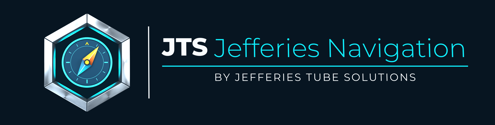
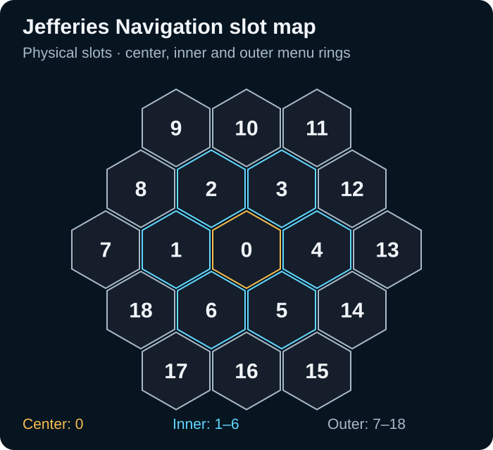
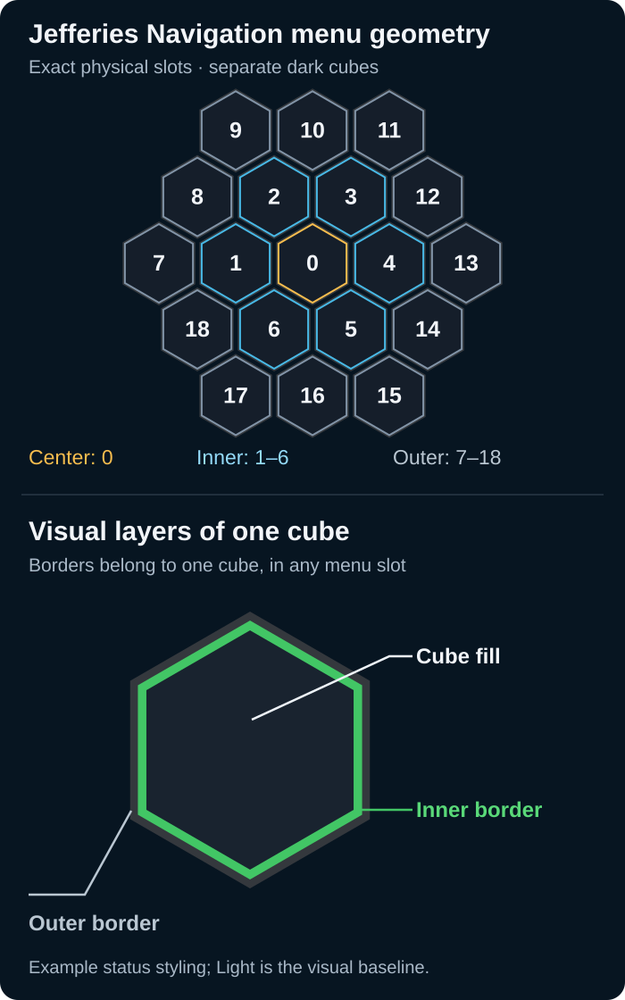
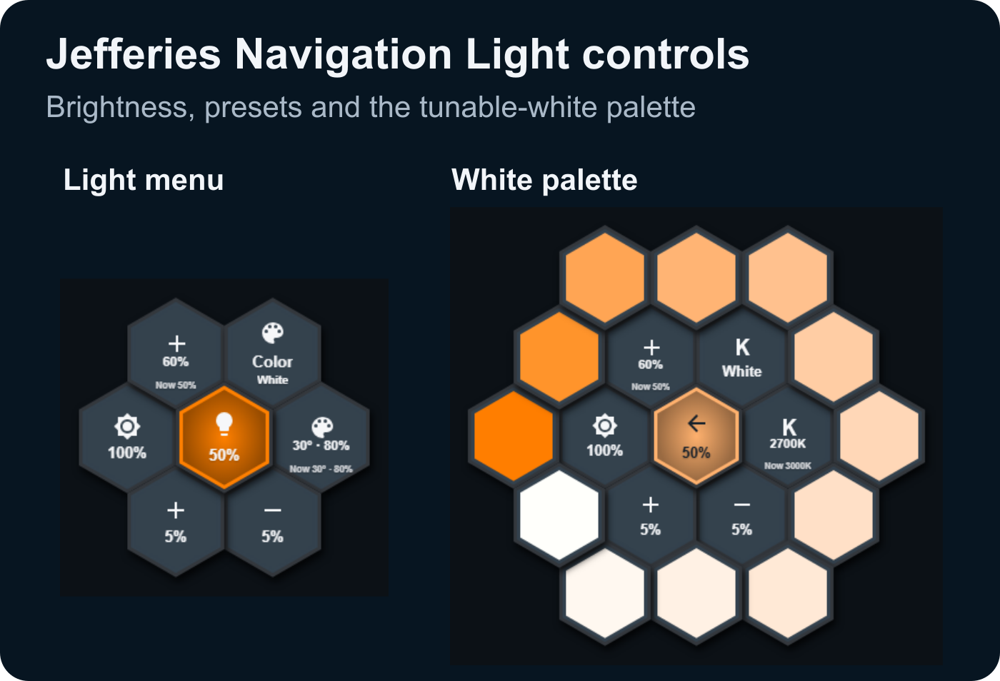

<p align="right">
  <a href="https://github.com/Jefferies-Tube-Solutions/jefferies-navigation/releases/latest">
    
  </a>
</p>

<p align="center">
  
</p>

# Jefferies Navigation for Home Assistant

## Mission Directive

Compact hexagonal controls for dashboards, floorplans and wall tablets. A persistent
**Hub** groups devices; a standalone **Control** exposes one device. Tap for the
primary action and hold for Light, Media or Sonos controls. Both use the same
full-cell renderer, with **82 CSS px cube width** by default.

Jefferies Navigation (JTS-N) continues Honeycomb Menu NG, a fork of
[Sian Croser's honeycomb-menu](https://github.com/Sian-Lee-SA/honeycomb-menu).
The project retains its original code and attribution under [GPLv3](LICENSE).
Nicolai Tandrup maintains the project. [Support the original author](https://www.buymeacoffee.com/SianLee).

> **v2.0.0** introduces the Navigation Compass and its own dashboard
> identifiers. See [Upgrading from Honeycomb Menu NG](docs/V2_MIGRATION.md) for
> the resource and YAML changes. The previous stable release is [v1.10.0](https://github.com/Jefferies-Tube-Solutions/honeycomb-menu-ng/releases/tag/v1.10.0).

## System Registry

| Component | Contract |
| --- | --- |
| Home Assistant | Dashboard plugin installed through HACS or as a JavaScript module |
| Navigation Hub | `custom:navigation-hub` groups controls on a dashboard or floorplan |
| Navigation Control | `custom:navigation-control` exposes a single device |
| Rendering | Shared hexagonal cells, fixed or responsive sizing and capability-aware controls |
| Version | The badge shows the latest published stable release. |

## Commissioning

### Install and update


You need current Home Assistant, [custom:button-card](https://github.com/custom-cards/button-card)
and the entities you want to control. Install button-card and its JavaScript module
resource first. Sonos features use HA's official Sonos integration.

**HACS:** add `https://github.com/Jefferies-Tube-Solutions/jefferies-navigation` under Custom
repositories, category **Dashboard**, then install. Select the intended version;
a beta requires showing prereleases. The normal module resource is
`/hacsfiles/jefferies-navigation/jefferies-navigation.js`. Check Dashboard resources for
one entry, type **JavaScript module**; avoid loading HACS and manual copies together.

**Manual:** download the bundle from the intended
[GitHub release](https://github.com/Jefferies-Tube-Solutions/jefferies-navigation/releases), place it
at `/config/www/jefferies-navigation.js`, then register this resource
(in the Dashboard resources UI, or under `lovelace:` in YAML-managed configuration):

```yaml
resources:
  - url: /local/jefferies-navigation.js
    type: module
```

After updating, reload the browser/app and hard-refresh if cached JavaScript persists.
Check the installed release and resource URL before changing YAML. Installing a stable
release does not make newer beta-only options available.

### Start in 60 seconds


Add a Manual card and paste this complete [Hub example](examples/v1.7/hub.yaml).
Replace the synthetic IDs with entities from HA Developer Tools → States.

```yaml
type: custom:navigation-hub
name: Hub A
size: 82
logo: auto
items:
  - type: light
    entity: light.zone_a
    name: Light A
  - type: sonos
    entity: media_player.player_a
    name: Player A
```

Tap Light to toggle; tap Player to play/pause. Hold either to open its module.
A dimmable Light has brightness and a capability-aware palette. A Light explicitly
reporting `supported_color_modes: [onoff]` toggles and shows On/Off without a detail
menu. Missing attributes during unavailability do not establish on/off-only capability.

## Operational Protocol

### Layout model


These are **physical slots**, viewed face-on. The figure is checked against the
current coordinate tables, not inferred from button order.

<!-- layout-diagram:start -->

<!-- layout-diagram:end -->

| Area | Physical slots | Meaning |
|---|---|---|
| Center | `0` | Hub item or compass; selected module's locked center |
| Inner ring | `1–6` | Six immediate neighbors |
| Outer / second ring | `7–18` | Twelve neighbors outside the inner ring |
| Further Hub rings | `19–36`, `37–60`, `61–90`, `91–126`, `127–168`, `169–216` | Expand on demand |

Private local testing: [fixed development resource and build instructions](docs/DEVELOPMENT_BUILDS.md).
[Unpublished beta.6 scope, measured limitations and future-module boundaries](docs/BETA6_REVIEW.md).

#### Canonical visual baseline: Light module

**All modules use the existing Light module as their graphical baseline** — Sonos/Media, Climate, Car, Charger and future modules. Keep consistent 82px hex cube geometry, cube fill/inner/outer border layers, icon and label placement, typography, spacing and nested-menu navigation. Module-specific behavior and colors may differ, but modules must not introduce their own competing layout styles. Follow the [shared visual design contract](docs/TERMINOLOGY.md#shared-visual-design-contract--light-is-the-canonical-reference) and compare new module screens side by side against Light on desktop and mobile.

#### Naming standard: menu rings vs cube borders



When reporting layouts or visual bugs, distinguish **menu geometry** (multiple
cells) from the **visual layers of one cube**:

| Term | Refers to |
|---|---|
| **Center cube** | Physical **slot 0** |
| **Inner menu ring** | Separate menu cubes in **slots 1–6** |
| **Outer menu ring** | Separate menu cubes in **slots 7–18** |
| **Cube fill / center fill** | Background **inside one cube** (`colors.center`) |
| **Inner border** | The **inner border of one cube** (`colors.inner_border`) |
| **Outer border** | The **outer border of one cube** (`colors.outer_border`) |
| **Persistent Hub launcher** | Always-visible dashboard launcher; **not automatically slot 0** |
| **Module launcher** | Cube in Hub menu opening a module |
| **Promoted center cube** | Selected module shown at slot 0 of its submenu |

Other agreed terms include **cube icon**, **cube artwork**, **cube label**,
**back cube**, **action cube**, and **favorite cube**.

**Avoid ambiguous references to an “inner ring” or “outer ring.”**
Use **menu ring** for the spatial arrangement of separate cubes and
**inner border / outer border** for the visual layers of one cube.

The complete layout glossary, role distinctions, examples and Classic-menu
exceptions are in **[Layout terminology](docs/TERMINOLOGY.md)**.

The current Hub renderer supports **217 physical positions including center**.
Configured items are not capped at 7 or 18: items beyond physical capacity remain
tracked and report overflow. Large layouts may clip near viewport edges; there is
no paging or automatic shrinking.

**Classic popups:** their ring `slot` numbers also start at 1, but their center is
configured separately with `center_button`, not `slot: 0`. Legacy `position: 0`
means the first ring position. Classic `size` defaults to **225** and describes
the scene extent; it is not the Hub/Control 82 px cell width. Classic automatic
layouts use the inner ring for 1–6 buttons, outer for 7–12, and both for 13–18;
hard targets can activate additional rings. See the [classic reference](docs/CLASSIC_MENU.md).

#### Automatic Hub layouts and branding

Without explicit dynamic placement, these established layouts remain unchanged.
Columns list slots in configuration order; count means configured non-null items,
including currently hidden items.

<!-- auto-slots:start -->
| Items | Without logo | With logo |
|---:|---|---|
| 1 | `0` | `2` |
| 2 | `2,3` | `2,3` |
| 3 | `2,3,0` | `2,4,6` |
| 4 | `1,2,0,3` | `2,3,1,4` |
| 5 | `1,2,0,3,4` | `1,2,3,4,5` |
| 6 | `1,2,3,4,5,6` | `1,2,3,4,5,6` |
| 7 | `0,1,2,3,4,5,6` | logo suppressed; same slots |
<!-- auto-slots:end -->

`logo: auto` shows the compass for **2–6 configured items**, leaving one item at
center and suppressing branding for 7+. `logo: true` also shows it for one item.
An explicit center-slot request takes precedence over branding. `logo: false`
removes the compass and makes slot 0 available to ordinary items; it does not force
every automatic layout to fill the center. Beyond seven, automatic items use
`0,1,2,…`.

#### Placement and live visibility

| Mode | Visible | Hidden | Collision rule |
|---|---|---|---|
| `hard` (default) | Exact slot, explicit or established automatic position | Slot stays reserved | First configured hard item wins |
| `priority` | Preferred explicit slot; fallback when occupied | Releases slot | Hard wins; all priority preferred claims precede fallback placement |
| `soft` | Free slot; keeps its current free position | Releases slot | Runs after priority; no needless compaction |

Equal claims use configuration order. Priority reclaims its preferred slot when
it becomes visible. Unaffected free positions remain stable. Structural changes
wait while the Hub's module/nested menus, pointer/touch/drag or delayed tap are
active; the latest state is applied together after returning to base/finishing the
gesture. Labels and entity presentation continue updating. Multiple Hubs are independent.

This complete [dynamic example](examples/v1.7/dynamic-hub.yaml) keeps a Light at
center, prefers slot 2 for Person A when home, and uses free slots for other items:

```yaml
type: custom:navigation-hub
name: Dynamic Hub A
size: 82
logo: false
items:
  - type: light
    entity: light.zone_a
    slot: 0
    slot_mode: hard
  - type: generic
    entity: person.person_a
    name: Person A
    slot: 2
    slot_mode: priority
    visibility:
      - condition: state
        entity: person.person_a
        state: home
    tap_action:
      action: more-info
  - type: generic
    entity: light.zone_b
    name: Bright light B
    slot_mode: soft
    visibility:
      - condition: numeric_state
        entity: light.zone_b
        attribute: brightness
        above: 127
        below: 256
    tap_action:
      action: more-info
  - type: media
    module: media
    entity: media_player.player_b
    slot_mode: soft
    visibility:
      condition: state
      entity: person.person_a
      state: not_home
```

HA Light `brightness` is **0–255**, not percent; numeric bounds are exclusive.
`not_home` is HA's literal away state; named zones have their own states.
Visibility supports state/attribute equality or exclusion, numeric thresholds,
AND, OR and NOT. A top-level list is AND; omitted/empty visibility is true.
Only a final true result shows an item. Missing/indeterminate values hide unless
another logical branch determines the result; unknown/unavailable state strings
can be explicitly matched. Legacy `show` is an additional AND gate.
These keys belong to **Hub items**, not standalone Control or submenu buttons.
[Exact conditions, truth tables and collision rules](docs/V1_7_PHASE2.md).

### What you can build


- Persistent Hubs and individual Controls with consistent icons, labels and rings.
- Light brightness, Color/White palettes and reusable numeric presets.
- Media/Sonos play/pause, group-aware volume, favorites artwork and optional Join.
- Live Hub item visibility, reserved/preferred/free slots and stable placement.
- Nested menus, drag-select and classic popups, templates and XY Pad.

See the [Climate guide](docs/CLIMATE_MODULE.md), [Hub example](examples/climate-hub.yaml)
and [standalone Control example](examples/climate-control.yaml).
Jefferies Navigation calls configured HA actions; device automation belongs in Home Assistant.

See the [Light menu and White palette](#light-menu-and-white-palette) for a worked example.

### Responsive room controls


Add `collapsible: true` and a primary item in slot 0 to place a compact,
responsive room control on a floorplan. Tap performs its action. Hold reveals
other visible cubes, or opens the primary's controls directly if it stands alone.
On phones, tablets and PCs, the Hub opens at a comfortable size. It prefers
space beside the floorplan, and fits safely in the viewport when there is no room.
On constrained screens, it places actual visible controls in fitting free canvas,
preferably below the image, at the already chosen expanded size. Desktop placement
plans for slots 0–18 and accepts at most 15% initial downscaling in free space,
and otherwise stays near the original floorplan anchor. Only configured cubes
render. Tap its center to return. Hold the expanded primary to open its controls
or run its configured hold action. No extra sizing or positioning options are needed.

```yaml
type: custom:navigation-hub
style: {left: 50%, top: 50%}
collapsible: true
items:
  - type: light
    entity: light.room_a
    slot: 0
  - type: light
    entity: light.room_b
    slot: 2
```

Optional Beam of Origin keeps the original room cube visible as a live,
noninteractive reference while the expanded Hub moves away. Enable it with:

```yaml
collapsible:
  beam_of_origin: true
```

Optional custom color:

```yaml
collapsible:
  beam_of_origin:
    color: "#8bdcff"
```

The soft cyan beam fades toward the active expanded controls and follows nested
navigation. `collapsible: true` leaves the beam off.
The source reference cannot toggle or open anything; closing restores the single
interactive room cube. Near/overlapping or hidden sources suppress the beam.

See [complete picture-elements examples and optional settings](docs/COLLAPSIBLE_HUB.md).
Auto/omitted Hub size sets an 82px nominal maximum for expanded and nested cubes;
a responsive collapsed floorplan cube may be smaller. Numeric `size: N` sets the
maximum to N, including values above 82. Optional `collapsible.expanded_size` can
lower that target but cannot raise the parent limit. Viewport fitting may shrink
further. The same ceiling applies throughout navigation and exact Back restoration.
Selected module cubes stay in place when their submenus fit; constrained views
fall back to the expanded root center. Back restores the parent layout exactly.
Explicit numeric sizes are unchanged. Legacy
`collapsible.mobile` remains an alias for `small_screen`; conflicting values fail
clearly. Hubs without `collapsible` keep their existing defaults.

Developer diagnostic (optional): add top-level `size_debug: true` to show the
actual rendered CSS-pixel cube width during the Compass's temporary version reveal.
When omitted, inspection shows the version alone.
Normal Compass tap inspects; expanded-root Compass tap stays Back, hold/Shift+Enter inspects.
See [measured diagnostics and YAML](docs/NAVIGATION_COMPASS.md).

Sonos Join prefers trusted station artwork with room name and individual volume.
Climate adjustments are ±1.0 and ±0.1 in HA's temperature unit; unsupported
precision is disabled. Keyboard focus follows the hex, with no pointer rectangle.

### Actions, appearance and navigation


- Tap, hold and optional double tap use HA action objects (`toggle`, `more-info`,
  `perform-action`, `navigate`, `url`, `fire-dom-event`, `none`). Configured action
  overrides replace the module's action. Default hold enters its menu.
- Drag-select and nested back navigation are preserved. Selecting a base item may
  establish a module center; after entry its physical slot 0 stays fixed until base.
- Missing/unavailable devices retain their icon and show gray **Unavailable**;
  recovery updates presentation. Visibility can separately hide them.
- `colors.center`, `colors.inner_border`, `colors.outer_border` control fill and
  ring colors; `border.inner_width` / `outer_width` control ring widths. Use shared
  ring keys rather than rectangular CSS borders. Modules provide live active color.
- `styles`, labels and templates support advanced customization. See the
  [AI key reference](docs/AI_SETUP.md#configuration-contract) and
  [classic popup/template/XY Pad reference](docs/CLASSIC_MENU.md).

#### Compass version feedback and development updates

Tap the standard Jefferies Navigation Compass to reveal the actual installed version inside its
hexagon for three seconds. Hold works too. At the expanded Collapsible root,
short tap is Back/Collapse; hold or Shift+Enter reveals the same version without
collapsing. Enter/Space remains Back. Alt+V provides keyboard version inspection
on Compass icons that retain another contextual action. Reduced motion suppresses
animation while retaining readable version feedback. All use one canonical compass
asset and shared rendering/version code. [Shared Compass guide](docs/NAVIGATION_COMPASS.md).
[Development installation and cache troubleshooting](docs/DEVELOPMENT_BUILDS.md).

### Choose a module or Control


| Hub item | Standalone Control | Features |
|---|---|---|
| `type: light` | `module: light` | Toggle, brightness, Color/White, presets |
| `type: sonos` | `module: sonos` | Play/pause, group volume, Join, Radio, Sleep (beta.6 candidate) |
| `type: media` + `module: media` | `module: media` | Generic media without Sonos menus |
| `type: generic` | `module: generic` | Custom entity/actions, no domain menu by default |

Bare Hub `type: media` retains its older **Sonos** meaning. Use explicit selection
for new configurations. Core owns rendering, geometry and navigation; modules
provide behavior. There is no separate Control visual engine.

For a single device, use this [Control example with presets](examples/v1.7/control-light.yaml):

```yaml
type: custom:navigation-control
module: light
entity: light.zone_a
name: Light A
size: 82
presets:
  brightness:
    entity: number.relay_a_brightness
  kelvin:
    entity: number.relay_a_kelvin
  color:
    hue_entity: input_number.preset_a_hue
    saturation_entity: input_number.preset_a_saturation
```

**Control migration:** use `module` and the shared appearance/action keys. Replace
older standalone examples using inset sizing or `menu_size`; `size: 82` now means
cell width. Control has no Hub `items` list or item-level dynamic allocation.
[Detailed migration and supported keys](docs/AI_SETUP.md#migration-and-limits).

#### Light menu and White palette

The **Light menu** (left) shows brightness and presets. The **White palette**
(right) shows the twelve Kelvin swatches for a tunable-white light.



[Navigation capture provenance](docs/assets/screenshots/navigation-light-provenance.json)
· [Historical v1.8.1 capture provenance](docs/assets/screenshots/stable-provenance.json).
The historical v1.8.1 stable release did not include Charger.

#### Light Hub names while OFF

An OFF Light Hub launcher shows its
existing item `name` above `OFF`. Without a custom name it uses the HA
`friendly_name`, then the readable entity ID. A short name such as `A` is valid;
long names use the existing ellipsis. ON brightness/colors and submenu centers
keep their existing presentation. Unknown/unavailable lights say `Unavailable`,
never `OFF`. Existing explicit secondary-label overrides still take precedence.

#### Light capability reference

Jefferies Navigation reads HA `supported_color_modes`, never brands or names. Mode selection
on cube **3** is UI-only; slot 0 retains its normal name/value/Back presentation.

| Advertised capability | Controls | Palette launcher |
|---|---|---|
| `onoff` only | Toggle; no detail menu | None |
| `brightness` or fixed `white` | Brightness/presets | No Color/Kelvin commands |
| `color_temp` only | Brightness and White/Kelvin | White only; no Color hold |
| `hs`, `xy`, `rgb`, `rgbw` or `rgbww` only | Brightness and Color | Color only |
| Color plus `color_temp` | Brightness, Color and White/Kelvin | Tap current/viewed palette; hold opposite |
| Missing/inconsistent capabilities | Only verified controls | No invented capabilities |

For dual-mode lights, HA `color_mode` chooses the initial palette. Off/null uses
reliable same-entity session memory, otherwise a deterministic supported fallback.
A manual palette selection stays selected while browsing/zooming. White/Kelvin
requires real min/max bounds. Opening, switching, holding and Back send no light
command; a deliberate swatch tap applies it. Unknown/unavailable is never OFF.
[Full Light rules and short-name examples](docs/AI_SETUP.md#light-capability-and-off-name-rules-beta6-candidate).

#### Light presets

Light detail slots are: **1** 100%, **2** brightness preset, **3** Color/White
(or passive Light for brightness-only), **4** standard color/Kelvin,
**5** −5%, **6** +5%. Color or White palettes add slots 7–18 without moving the center cube. In beta.7,
White swatches are solid temperature colors: tap applies; hold refines without
calling HA. Back restores the prior palette, and full close resets it. Native
Kelvin bounds and integer-precision limits apply; no new YAML options are needed.

In v1.9.0-beta.4, HA `supported_color_modes` selects available palettes. For a
Color + White light, tap slot 3 for its current `color_mode`; hold for the other
supported palette. Cube 3 names the displayed palette and its alternative (v1.9.0-beta.5).
Navigation sends no light command. White-only exposes no Color alternative;
fixed-white keeps brightness controls, and on/off-only keeps toggle only.


Preset values may be writable `number.*` entities on **another relay/device or
integration**, or `input_number.*` helpers. They need not belong to the Light.
Brightness is 0–100%, hue 0–360, saturation 0–100, Kelvin must suit the Light.
Tap applies; hold stores the current value. With no helpers the apply-only
fallbacks are 60% and 2700 K. On a color-capable Light, configured hue+saturation
take precedence over Kelvin for slot 4. [Light reference](docs/LIGHT_MODULE.md).

#### Sonos and external HA setup

Group volume, room discovery/Join and native device Sleep need no helper scripts.
Radio still needs HA's **official native Sonos favorites entity** enabled; supply
its actual ID with `favorites_sensor` (default `sensor.sonos_favorites`).

**Breaking change in v1.8.0-beta.4:** supported read-only HA Browse Media is now
Sonos's default and only favorite-artwork/metadata provider. Remove
`favorites_cache_sensor` from dashboard YAML and remove the custom favorites-cache
template definition/refresh automation previously used only for Jefferies Navigation. Keep
unrelated templates and the **native** favorites entity. No legacy sensor lookup,
autodetection, fallback or compatibility shim remains, even if the entity exists.
Browse errors safely show icon/text. No special artwork option or backend install.
The owner has already migrated and selected the v1.8.0 release track. Existing
tagged v1.7.1 remains unchanged; no legacy cache functionality is restored.

See [complete native examples, migration and DevTools proof](docs/SONOS_NATIVE_FAVORITES.md),
[Sonos reference](docs/SONOS_MODULE.md), [native Sleep](docs/SONOS_SLEEP_TIMER.md)
and [the complete card](examples/v1.7/sonos.yaml). `members` and a custom
[toggle script](examples/sonos-toggle-member.yaml) remain optional grouping overrides.

Sonos inner slots are **1 Radio,
2 Play/Pause, 3 Solo/Join, 4 Sleep, 5 Volume Down, 6 Volume Up**. Join shows live
station artwork, room name and individual volume, with membership/playback
available in accessible labels and an explicit setup/availability state. Radio's outer submenu
retains its ordering, artwork and playback, with new stable favorite accent rings.
A reliably identified favorite can provide native launcher artwork and playing
color; pause/stop remains neutral. See [matching limits and styling precedence](docs/SONOS_MODULE.md#v171-beta-station-accents-and-launcher-artwork).

### Charger dashboards


The Charger/Easee module shares the same
82px renderer, gradients, sizing and power-sensitive hexagonal pulse. A Charging
Hub sums fresh verified power and physically connected cars; named chargers open
fixed detail menus. Permission and permanent-lock controls require deliberate taps
on verified HA switches. Opening/Back/state updates never issue charging commands.

- [Complete one-Easee dashboard](examples/charger-easee.yaml), with no vehicle feed.
- [Complete two-charger dashboard](examples/charger-multi.yaml), with optional
  external vehicle associations; it also works when that sensor is absent.
- [Element-only snippet for an existing floorplan](examples/charger-elements.yaml).
- [Installation, entity checklist, source-backed capabilities and safe HA tests](docs/CHARGER_MODULE.md).

Named chargers show vehicle/connection and fixed charger name in two rows; fresh
charging power stays visible beside the icon. Sonos launcher, promoted center and Radio favorite artwork share an inset safe
area that avoids the sloping hex edges, preserves aspect ratio and reserves labels. Dashboard editor previews own their overlays and cannot send actions.

All example IDs and screenshots are synthetic replacement points. Replace them
with your actual integration entities. Car identification, schedules, load balancing and optimization run in external automation.

## Verification

For local development: `npm ci`, `npm test`, then
`NODE_OPTIONS=--openssl-legacy-provider npm run build` (webpack 4).
Browser and docs checks run in CI with pinned test dependencies. Configuration
examples are checked in synthetic HA on desktop/mobile; real devices still need
installation-time validation.

## Fault Isolation and Recovery

If Marketplace shows the old Honeycomb README after installing v2, refresh the
repository information from its Marketplace page. Check the installed version
separately. The version badge in this README reports the latest stable release.

If nothing renders, check both module resources, version/cache, browser errors and
entity IDs. For missing favorites check the official sensor; for missing artwork
check native Browse Media responses/permissions and browser access to thumbnail URLs. Join needs its
script and candidate list. A hidden hard item intentionally leaves a hole.

## Manuals

- [Versioned AI setup guide and six tested YAML examples](docs/AI_SETUP.md)
- [Light](docs/LIGHT_MODULE.md) · [Sonos](docs/SONOS_MODULE.md) · [Classic popups](docs/CLASSIC_MENU.md)
- [Phase 1 / Issue #78](docs/V1_7_PHASE1.md) · [Phase 2 conditions and allocation](docs/V1_7_PHASE2.md)
- [Architecture and invariants](ARCHITECTURE.md) · [v2 release notice](RELEASE_NOTES.md)
- [Complete Honeycomb Menu NG v1 release history](https://github.com/Jefferies-Tube-Solutions/jefferies-navigation/blob/25291186b07bfee81b8877fe731e00a417d56c12/RELEASE_NOTES.md) · [v1.10.0 stable verification](docs/V1_10_STABLE_RELEASE.md)
- [Documentation audit and validation commands](docs/DOCUMENTATION.md)

## Operations Log

### Help, reference and development

- [Captain’s Log](docs/CAPTAINS_LOG.md)

Stable releases use the exact tested master commit, matching metadata, tag, bundle,
checksums and HACS asset. See the [publication and verification guide](docs/RELEASING.md).
Release retention remains **disabled**: the owner verified
`RELEASE_RETENTION_ENABLED=false`; the stable publisher forces its retention report
read-only. This preparation never changes settings or deletes Release records.
Before any future activation, review a fresh [retention dry-run](docs/RELEASE_RETENTION.md).
Deleting a Release record removes its uploaded assets; its Git tag and tagged
source remain. Tags, branches and source history are never cleanup targets.

## Approved artwork

[JTS artwork and product identity](docs/BRANDING.md)
